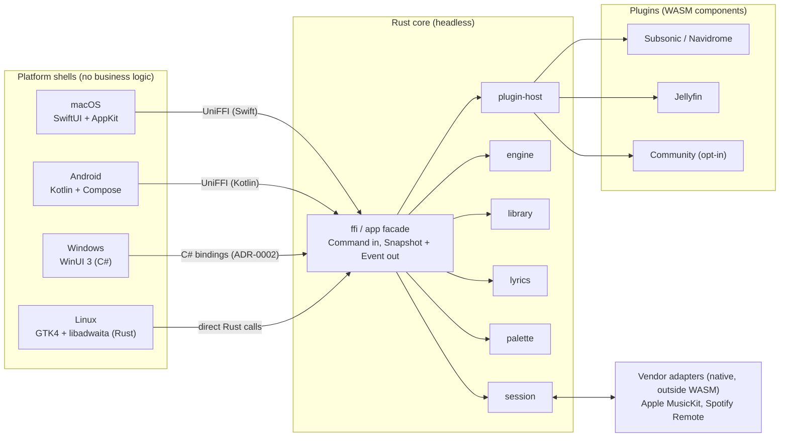
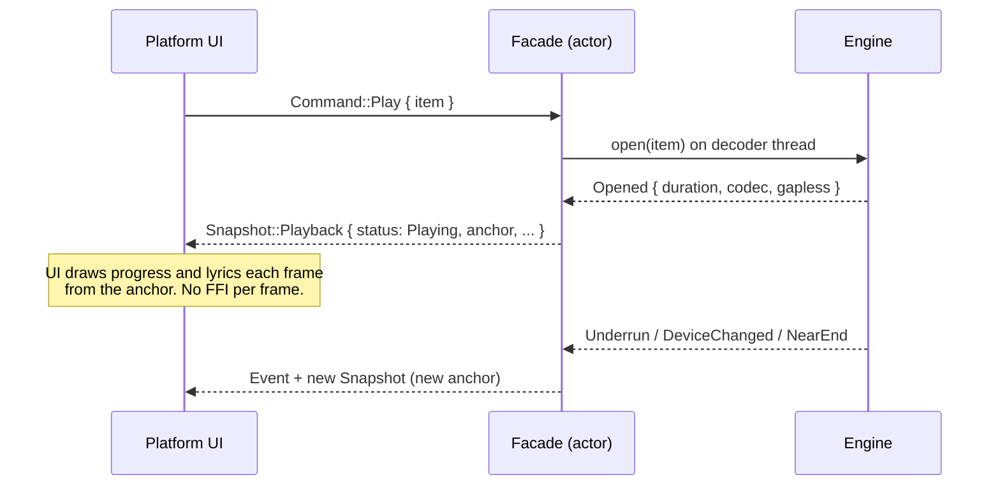
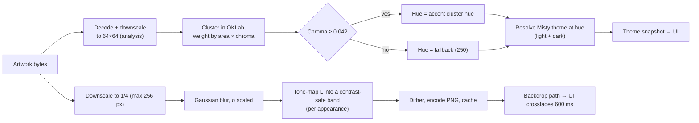

# Architecture overview

Status: **proposed (Step 0)**. Decisions that needed verification are in
[`adr/`](adr/); this page shows how the parts fit together.

## 1. Principles

1. **One brain.** A headless Rust core owns all state: playback, queue,
   library, lyrics, theme, sources, settings. Platform UIs render state and
   send intents. They hold no business logic.
2. **One direction.** UIs send `Command`s. The core applies them and
   publishes versioned state snapshots and events. A UI never mutates
   a mirror of core state on its own.
3. **No per-frame FFI.** Anything that moves every frame (progress, lyrics
   highlight) is interpolated in the UI from a *playback anchor* the core
   publishes on change. Lists are paged on demand; images travel as file
   paths, not bytes.
4. **Everything online is a plugin.** The core ships only "Local files".
   Every service runs as a sandboxed WebAssembly component with declared
   capabilities and a network allowlist.
5. **Native chrome, shared content.** Each platform keeps its own window
   controls, menus, shortcuts, focus and accessibility. The content area uses
   one token set (Misty-based, generated from `design/tokens.json`).
6. **Measured, not assumed.** Every budget in [`milestones.md`](milestones.md)
   has a named measurement and tool per platform.
7. **Trade-off order.** When goals conflict: performance, animation and
   design effects first; resource use and app size second.

## 2. System context



Vendor adapters (Apple Music, Spotify Connect) are native code in each
platform shell, because they wrap vendor SDKs. They plug into the session
through a narrow `ExternalPlayer` interface; see ADR-0010 and ADR-0011.

## 3. Core crates

| Crate | Owns | Key dependencies (versions pinned in ADR-0014) |
| --- | --- | --- |
| `jf-engine` | Decode, resample, DSP (ReplayGain, parametric EQ, limiter), gapless splice, crossfade, output devices, HTTP range streaming with read-ahead | symphonia, cpal, rubato, reqwest |
| `jf-library` | SQLite catalogue, tag reading, incremental scan, file watching, full-text search; filesystem behind `FileSystem` trait (Android implements it over SAF) | rusqlite (bundled, FTS5), lofty, notify |
| `jf-lyrics` | Parsers for LRC, enhanced (word-level) LRC, TTML, WebVTT into one `LyricDoc` with translation and romanization tracks; timeline precomputation | quick-xml |
| `jf-palette` | Artwork colour extraction in OKLab, Misty theme resolution from one hue, contrast-safe text, baked blurred backdrops | image (or zune-jpeg + png), own OKLab code |
| `jf-plugin-host` | Load, verify and run WASM plugins; host imports (http, kv, crypto, clock, log); epoch and memory limits; auth-flow state machines; unified search merge | wasmtime LTS (ADR-0003), reqwest |
| `jf-session` | Queue, shuffle/repeat, history, persistence and restore, media-session state, vendor `ExternalPlayer` routing | |
| `jf-core` | The app facade: actor loop, `Command` dispatch, snapshot assembly, settings, secrets via `SecretStore` trait | tokio (small runtime), tracing |
| `jf-ffi` | UniFFI bindings for Swift and Kotlin; C# bindings per ADR-0002 | uniffi |
| `jf-tokens` | Generated design tokens for Rust (GTK shell) | generated |

Supporting crates: `jf-plugin-sdk` (guest-side Rust SDK), `jf-plugin-cli`
(scaffold, test, package), `jf-mock-server` (HTTP fixtures for plugin tests),
`jf-cli` (the Milestone 1 headless player), `xtask` (codegen and builds).

## 4. Threads and runtime

| Thread | Job | Rules |
| --- | --- | --- |
| Core actor (1) | Owns state; applies `Command`s in order; emits snapshots and events | Never blocks on I/O; long work goes to the pools below |
| Audio callback (cpal, real-time) | Pulls from a lock-free SPSC ring and applies volume | No allocation, no locks, no syscalls, no logging |
| Decoder (1 per live stream, at most 2) | Decode, resample, DSP, write to ring; prepares the next track for gapless and crossfade | Bounded ring (about 2 s at device rate) |
| I/O runtime (tokio, 2 workers) | HTTP streaming, plugin HTTP imports, artwork fetch | Per-plugin rate limits and timeouts |
| Plugin workers (pool of 2) | Run plugin calls with fuel/epoch and memory limits | A call never runs on the actor or audio thread |
| Plugin epoch ticker (1) | Advances wasmtime's epoch every 5 ms while plugin code runs | Parks while no call is in progress |
| Source helpers (`jf-sources`, `jf-search`; one per browse, collection, stream URL, login) | Wait for plugin answers: installs, uninstalls and logouts in order, the search fan-out and merge, catalogue pages, stream URLs, sign-in steps | Report to the actor with messages; never block it |
| Library worker (1, low priority) | Scan, tag read, watcher events, artwork thumbnails, palette bake | Single SQLite writer; readers use WAL snapshots |
| Media worker (1) | Lyrics and artwork for the current track (through its plugin for source tracks), theme and backdrop bakes | Only the newest request matters |

Idle with playback paused, only the actor and the I/O runtime exist and
both are parked; no timers tick (the plugin host's epoch ticker parks too).
During playback the decoder wakes per ring-buffer refill, not per sample
block.

## 5. Data flow



### Commands and snapshots

* `Command` is one enum (play, pause, seek, set_queue, set_eq, query_library,
  plugin_login, …). Every command carries a client id; failures come back as
  `Event::CommandFailed { id, error }`.
* State is split into slices, each with a monotonically increasing version:
  `Playback`, `Queue`, `Theme`, `Lyrics`, `Sources`, `Settings`, `Devices`,
  `Scan`. A UI subscribes once and receives the full slice when its version
  changes. Slices are small (a queue slice carries ids and the visible window,
  not 10 000 rows).
* Large collections (library views, search results, long queues) are paged:
  `Command::Query { view, window }` returns `Event::Page { view, revision,
  rows }`. When the library changes, the core bumps `revision` and the UI
  re-requests its visible window. This keeps virtualised lists at 60 fps.
* Images cross the boundary as content-addressed file paths in the cache
  directory (`artwork/<blake3>/<size>.jpg`, `backdrop/<blake3>-<theme>.png`),
  so each platform loads them with its native, cached image pipeline.

### The playback anchor

```text
PlaybackAnchor {
  track_generation: u64,    // changes on every track or seek
  position_us: i64,          // audible position at anchor time
  anchor_mono_ns: u64,       // platform monotonic clock (below)
  rate: f32,                 // 0.0 paused/buffering, 1.0 playing
  duration_us: Option<i64>,
}
position(now) = position_us + (now_mono_ns - anchor_mono_ns) * rate / 1000
```

* The position is the *audible* one: the engine subtracts output latency it
  reads from the device timestamps, so lyrics match what the person hears.
* The clock starts when the output does, not when the engine first writes:
  until the device has consumed its first samples after a start, seek or
  resume, anchors carry rate 0; after that the position can be briefly
  negative while the output's own delay passes ("starts in N ms").
* The core re-anchors on play, pause, seek, rate change, track change,
  buffering, and when the audio clock drifts more than 15 ms from the
  extrapolation (checked every 100 ms for 2 s after the output starts, then
  once a second, on the decoder thread; published only when exceeded).
* Every platform reads the same clock the core stamps with:

| Platform | Core stamps with | UI reads |
| --- | --- | --- |
| macOS | `clock_gettime_nsec_np(CLOCK_UPTIME_RAW)` | `DispatchTime.now().uptimeNanoseconds`; `CADisplayLink`/`TimelineView` timestamps converted |
| Windows | `QueryPerformanceCounter` | `Stopwatch.GetTimestamp()` |
| Linux | `CLOCK_MONOTONIC` | `GdkFrameClock` frame time (`g_get_monotonic_time` base) |
| Android | `CLOCK_MONOTONIC` | `System.nanoTime()`; Compose `withFrameNanos` |

  An FFI contract test on each platform asserts the two clocks agree to
  within 1 ms.

### Lyrics without per-frame FFI

On track change the core sends `LyricsReady(LyricTimeline)`: the parsed
`LyricDoc` plus flat, sorted arrays of line and word start times. Each frame
the UI does one binary search into those arrays with the anchor-derived
time. That lookup is specified once, with shared test vectors in
`tests/contract/lyrics-cursor.json` that every platform's tests replay, so
four implementations of a ten-line search cannot drift apart.

### Drawing time without waste

Two helpers, specified in the core and ported (or bound) by every shell,
keep time-driven drawing smooth and cheap:

* **`DisplayClock`** (`jf-core::timing`) turns anchors into the position to
  draw. It never moves backwards while playing and spreads a re-anchoring
  correction of up to 250 ms over at least 100 ms (at most a 25 % speed
  change), so a progress bar or a word sweep does not jitter or un-sing a
  word. Seeks, pauses, resumes and new tracks show at once.
* **`LyricTimeline::next_change(t)`** gives the next time the active line or
  word changes or a word finishes; with the next second and the next step of
  a progress bar it tells a view when the screen next changes. Views sleep
  until then (`DisplayClock::wait_until`) instead of drawing every frame, and
  draw per frame only while something actually moves, such as a word sweep.
  While paused nothing is scheduled. `jf play` works this way: about 5
  redraws a second for progress, 11 with a word sweep, and no measurable CPU
  over quiet playback.

## 6. Theme and backdrop pipeline



* Misty derives every colour from **one hue** (OKLCH). The palette crate
  therefore only has to find a good hue in the artwork; Misty's own tables
  already hold every text pair above WCAG AA at all 360 hues and in both
  appearances. The core resolves colours (CSS Color 4 OKLab matrices,
  per-channel clipping, matching the Misty packages) and sends sRGB values,
  so all four UIs show identical colours.
* The baked backdrop is computed once per artwork and appearance and
  cached. Its lightness is clamped into a band where the Now Playing ink
  holds at least 4.5:1 against every pixel, so text contrast over the
  blurred artwork is true by construction and covered by property tests.
* Hue changes animate as a colour crossfade on `dur-4` (600 ms) with the
  Fluid curve. Blur radius, saturation and glass opacity never animate
  (Misty MAT-10).

## 7. Glass on each platform

| Effect | macOS | Windows | Linux | Android |
| --- | --- | --- | --- | --- |
| Now Playing backdrop | Baked image, crossfade | Baked image, crossfade | Baked image, crossfade | Baked image, crossfade |
| Tinted backdrop blur (Veil/Mist) | System materials + Misty tint | Acrylic + Misty tint | CSS `backdrop-filter`, GTK 4.22+ (ADR-0006) | Cloudy behind `GlassSurface`, API 31+ (ADR-0005) |
| Progressive blur at scroll edges | Scroll edge effect on macOS 26; masked material on 14–15 | Masked acrylic layer | Custom copy → blur → gradient-mask widget | Cloudy progressive blur on API 33+, else gradient scrim |
| Window material | Native sidebar material | Mica (Windows 11) | Solid (compositor blur is not portable) | n/a |
| Live blur layers per screen | ≤ 3 | ≤ 3 | ≤ 2 | ≤ 2 |
| Fallback to solid Cloud | Reduce transparency, Low Power Mode | Transparency effects off, battery saver | High contrast, Cairo renderer, GTK < 4.22 | Battery saver, API < 31, low-RAM device |

Details and the frame-time budgets are in ADR-0005, ADR-0006 and ADR-0007.

## 8. Library

* SQLite with WAL; one writer (library worker), many readers.
* Tables: `files`, `tracks`, `albums`, `artists`, `track_artists`, `genres`,
  `playlists`, `playlist_items`, `artwork`, `lyrics_cache`, `history`,
  `plugin_kv`, `settings`, plus FTS5 tables. Search uses a `trigram` FTS5
  table for CJK substrings alongside a `unicode61` table for word matching
  (bundled SQLite build; ADR-0014 confirms the version).
* Incremental scan compares `(path, size, mtime, file id)` and re-reads tags
  only for changed files. Desktop watches folders with `notify`, debounced.
* `FileSystem` trait: `list`, `stat`, `open` (returns a seekable reader),
  optional `watch`. On Android the Kotlin side implements it over the
  Storage Access Framework and hands Rust a detached file descriptor from
  `ParcelFileDescriptor`, so audio bytes never cross JNI.

## 9. Engine

```text
source (file | HTTP range | plugin stream)
  → demux + decode (symphonia; platform decoder for codecs it lacks, ADR-0008)
  → gapless trim (encoder delay/padding)
  → resample to device rate (rubato)
  → ReplayGain (track/album, preamp, clip guard)
  → parametric EQ (biquads, up to 10 bands)
  → crossfade mixer (equal-power; skipped inside an album when "album continuity" is on)
  → limiter (only when EQ or ReplayGain can push past 0 dBFS)
  → lock-free ring → audio callback (volume) → device (cpal; ADR-0009)
```

* HTTP streaming: range requests with a read-ahead buffer (default 10 s
  ahead, spilling to a capped temp file), re-resolving URLs before their
  `expires_at` through the owning plugin, reconnect with backoff.
* Device switching: follow the system default unless pinned; rebuild the
  stream on change and resume at the same audible position.
* Vendor tracks (Apple Music) never enter this pipeline; the UI marks them
  "Vendor playback: no EQ, crossfade or visualization".

## 10. Plugins

The full design is in ADR-0003 (runtime) and ADR-0004 (packaging, WIT,
permissions). Shape:

```text
plugin.jfpkg (zip)
  manifest.toml   id, name, version, api_version, author, official,
                  capabilities, network allowlist, auth kinds,
                  settings schema (JSON Schema subset), playback mode
  plugin.wasm     component targeting world `jellyfesh:plugin/source@1`
  icon.svg        optional
  signature       optional ed25519 signature over the above
```

* Exports (each optional, matching `capabilities`): `auth`, `search`,
  `browse`, `resolve-stream`, `lyrics`, `artwork`, `recommendations`.
* Imports: `http` (allowlist, per-plugin cookie jar, rate limits, timeouts),
  `kv` (plain values in SQLite, secrets in the OS keystore), `crypto`
  (hashes, HMAC, AES, RSA, random), `clock`, `log`. No filesystem, no
  sockets, no environment, no WASI filesystem.
* Every call gets a fresh instance from a pre-instantiated template, an
  epoch (CPU) budget, a memory cap and a wall-clock timeout. A plugin that
  exceeds limits three times in a row is disabled with a visible reason.
* Allowlists may reference settings (`${settings.server_url}`) so
  self-hosted servers work without a wildcard. Redirects are re-checked
  against the allowlist; private address ranges are blocked unless the
  allowlist entry came from a user-entered server URL.
* Auth flows (QR, OAuth with PKCE via the system browser and a loopback or
  custom-scheme redirect, cookie import, username and password) are state
  machines in the host. The UI renders them natively. Passwords are never
  stored: a password flow must exchange the password for a token in the
  same call.
* Unified search fans out to enabled plugins with per-source deadlines,
  streams partial results, and merges by ISRC, then by a normalised
  (NFKC, case-folded, bracket-stripped; Traditional/Simplified folding is
  not done yet) title + primary artist + duration within ±2 s.

### In the core (v0.0.3)

`jf-core`'s actor owns the `PluginHost` through `sources::Sources`
(`core/jf-core/src/sources/`), and nothing in it blocks the actor: plugin
calls answer on channels, and the threads that wait for them (table in
section 4) send the actor a message when it has to act (the queue, the
`Sources` slice) and emit events themselves otherwise (search sections,
browse pages, sign-in steps).

* **Management.** Installs, uninstalls and logouts run in order on
  `jf-sources`; while one is in flight the `Sources` slice is published only
  when it finishes, so it never shows a half-added plugin, and shutdown
  waits for them (a logout must delete the secrets). Community consent is
  `<data>/plugins/consent.json`; plugin icons are copied to
  `<cache>/plugin-icons/` under content-hash names; bundled packages
  (`Config::bundled_plugins`) are installed or updated at start, and those
  the person uninstalled are remembered in the settings store.
* **Secrets.** A `Selection` sits between the host and the store: the app's
  `SecretStore` or the system keystore (`keyring` 4: Keychain, Credential
  Manager, the Secret Service over zbus), checked once off the actor by
  reading an entry no plugin can name. Calls made meanwhile wait for the
  check; if it fails, secrets stay in memory for the run and the slice
  says `SessionOnly`.
* **Search.** The actor answers with the library at once and hands the
  plugins to `jf-search`, which waits 100 ms for a newer search (typing),
  asks every source in parallel, and on each answer merges everything so far
  (`jf_plugin_host::merge`) and publishes that source's section, plus any
  earlier section the answer changed. A newer search ends the current one,
  and an atomic "latest search" number drops anything older still on its
  way.
* **Items.** Every item the core lists (search, browse) is remembered by
  plugin and id (two generations of 10 000), so `Browse` and
  `Collection::Source` hand the plugin back the record it described.
* **Streams.** A source track is resolved on a `jf-resolve` thread when it
  is about to play and again ahead of time for the next entry; the engine
  gets `MediaSource::Http` once the URL is there, and its `StreamResolver`
  (the core's `Refresher`, keyed by queue uid) asks the plugin again when a
  URL expires or is refused. Artwork for the theme is fetched with the
  plugin's headers (same-origin redirects only); lyrics come through the
  plugin's `lyrics` export and `jf-lyrics`.

## 11. Platform shells

| | macOS | Windows | Linux | Android |
| --- | --- | --- | --- | --- |
| Toolkit | SwiftUI, AppKit where needed | WinUI 3, Windows App SDK | GTK4 + libadwaita via gtk4-rs | Jetpack Compose |
| Core access | UniFFI Swift package (XCFramework) | ADR-0002 bindings, `jellyfesh_core.dll` | Rust crates directly | UniFFI Kotlin, `.so` per ABI |
| Media session | MPNowPlayingInfoCenter + MPRemoteCommandCenter | SystemMediaTransportControls via `GetForWindow` interop; taskbar thumbnail buttons | MPRIS over D-Bus (zbus, in the shell crate) | Media3 `MediaSessionService` with a `SimpleBasePlayer` facade over the core |
| Secrets | Keychain | Credential Manager (DPAPI) | Secret Service | Android Keystore (Kotlin side of `SecretStore`) |
| Packaging (ADR-0016) | Universal DMG, ad-hoc signed | Installer `.exe` + portable `.zip`, self-contained | `.flatpak` bundle (GNOME 51 runtime) | APKs signed with our release key |

Shells contain view code, platform adapters (media session, secrets,
filesystem on Android, vendor players) and generated tokens. Nothing else.
A lint in CI fails a shell PR that adds a dependency outside an allowlist
per shell.

## 12. Cross-cutting

* **Errors:** typed error enums at the facade; user-facing messages are
  keys, translated in the shell.
* **Logging:** `tracing` with a rolling file in the app's log directory;
  plugin logs are namespaced and rate-limited. No telemetry by default.
* **Localisation:** one string source with ICU MessageFormat, generated into
  `.xcstrings`, `.resw`, `strings.xml` and gettext catalogues (Misty INT-10
  asks for whole messages). Launch languages: English, Simplified Chinese,
  Traditional Chinese, Japanese.
* **Accessibility:** every control has a platform accessible name; lyric
  lines are exposed as a list with the current line marked selected;
  reduce motion swaps karaoke sweeps for line-level highlight with no
  scrolling animation; reduce transparency turns every glass surface into
  solid Cloud (Misty MAT-08).
* **Releases and updates:** GitHub Releases linked from the website; a daily
  check of the website's release feed (can be turned off); downloads go
  through the browser while builds are unsigned (ADR-0016). Release builds
  bundle two community plugins (`plugins/community`, unsigned), which the
  core installs only once the person allows community plugins (ADR-0012,
  amended for v0.0.6).
