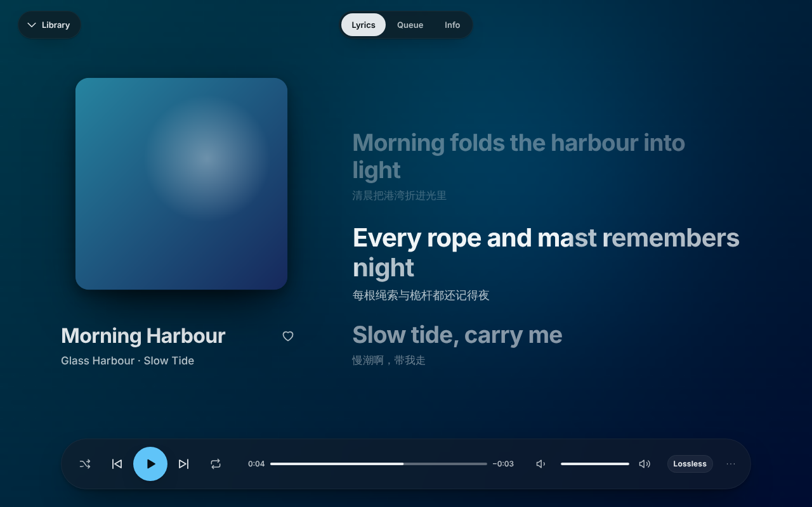
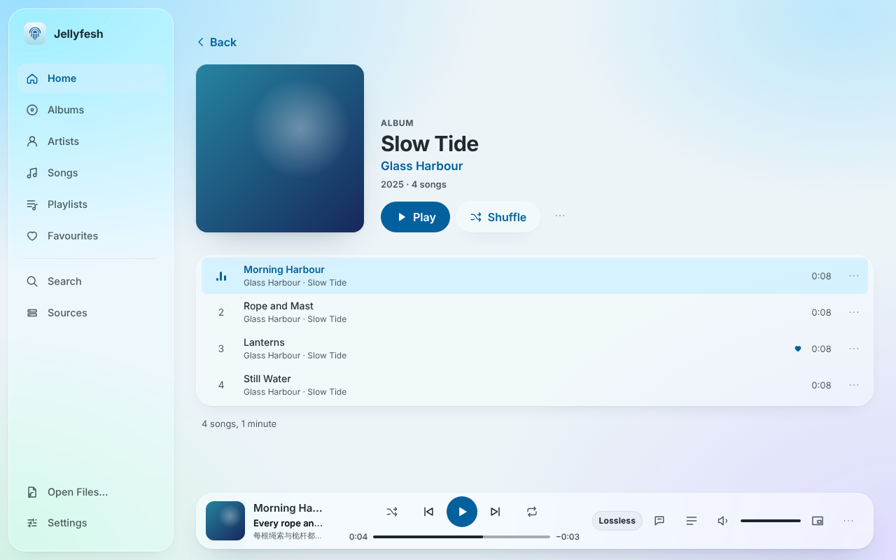
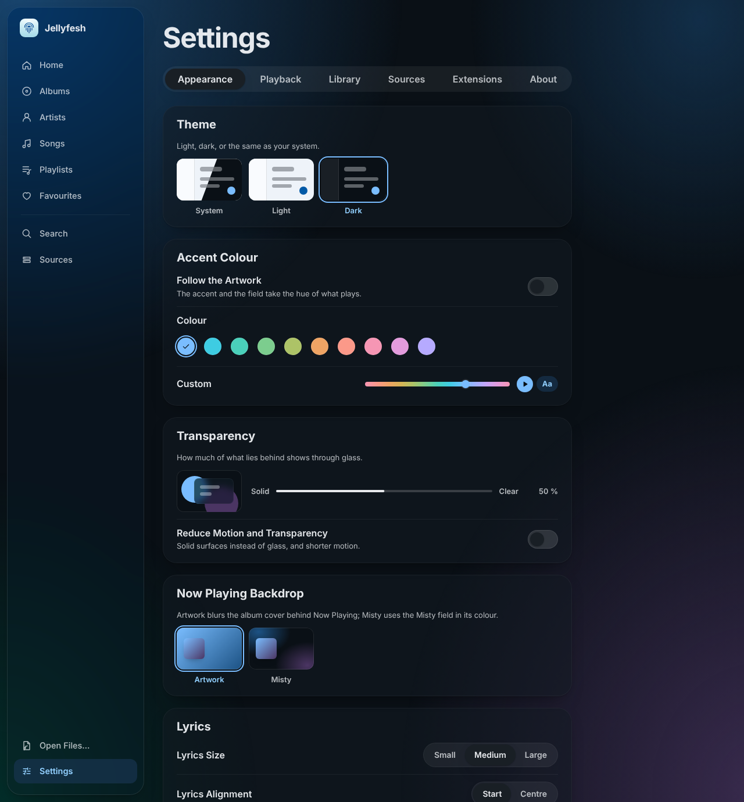

# Jellyfesh Web

Jellyfesh Web is Jellyfesh in the browser. It streams and browses your
**Subsonic, Navidrome or Jellyfin server**, keeps a **library of your own
music folders**, and installs **source plugins from `.jfpkg` files**, with
the same Now Playing as the apps (artwork, both backdrop styles, lyrics that
follow every word, with translation and romanization), the queue, search,
sign-in and settings, in Luminous, the v0.0.6 design (Misty, with the cover's
colour filling the room; [ui.md](ui.md)). Since v0.0.8 its layout is every
app's (Home, Albums, Artists, Songs, Playlists, Favourites, Search, Sources,
Settings; ADR-0023, [ui.md](ui.md)). It installs as a web app, lives on the
website at `/app/`, and plays audio files you drag onto it without keeping
them.

Hearts, Jellyfesh playlists and play history are kept in the browser, with
the same rules as the apps' library.



The screenshots in `docs/screenshots/web/` come from the app running against
the test servers in `platforms/web/tests/mock` and a generated music folder
(invented names, generated sine tones and gradient covers), hence
`-mock-server` in their names. Since v0.0.8 they are the reference the apps
match (ADR-0023 §5): every page (Home, Albums, Artists, Songs, Playlists, a
playlist, Favourites, Search and a source's tab, Sources, an album, Settings'
Appearance and Playback, the quality menu) light and dark, on a desktop and a
phone, with Now Playing in both backdrop styles and the player bar. They
were taken from a development build, whose plugins are not signed with the
release key, so Sources shows them as Community plugins; the website's build
signs them (`.github/workflows/web.yml`, with the `JF_PLUGIN_SIGNING_KEY`
secret).

## Using it

* **Open it** at the website's `/app/` (the "Open Jellyfesh Web" link on the
  home and download pages), or host it yourself (below).
* **Install it**, if you like: Settings › About › Install Jellyfesh Web where the
  browser offers it (Chrome, Edge), or the browser's own "Add to Home
  Screen" / "Add to Dock" (Safari). It then opens in its own window and
  starts without a connection; your server still has to be reachable.
* **Add music folders**: Home → Add Music Folder…, or Settings › Library →
  Add Folder…. Jellyfesh Web reads the folder through the browser (nothing
  is uploaded), keeps what the songs' tags say in IndexedDB, and lists it
  under Albums, Artists and Songs, with Search and Home's Recently Added.
  Lyrics files beside a song (`.lrc`, `.ttml`, `.vtt`) and embedded lyrics
  are used. The library is kept between visits, but not access to the
  folders: on a later visit you pick a folder again ("Pick Folder…") before
  its songs play. Chrome and Edge could keep a folder's handle, but reading
  a kept handle back has crashed Chromium-based browsers (the Chromium the
  tests run in, and [reports for Opera](https://forums.opera.com/post/382777)),
  and that crash would come at every start, so no browser keeps one. Rescan
  Library reads new, changed and removed files; browsers do not tell pages
  when files change, so there is no Watch Folders.
* **Hearts and playlists**: the heart (in a song's More menu and on Now
  Playing) marks a favourite; Add to Playlist… keeps songs together in a
  Jellyfesh playlist (New Playlist…, Rename…, Delete Playlist…, songs
  reordered by dragging their handle or with ↑ and ↓), library songs and
  server songs alike. Both are kept in this browser (IndexedDB, with
  `jf-library`'s rules through `jf_web::collections`), as are plays, which
  give Home its Recently Played and Most Played. A server's playlist can be
  kept as a Jellyfesh playlist with Save as Playlist…. Import Playlist…
  reads an M3U or M3U8 file: a page knows no folder's place on the disk, so
  each line becomes the library song whose path ends like it (its folder's
  name, then the path in it), and lines that match nothing are left out and
  counted. Export Playlist… saves the library songs that way
  (`Music/Album/01 Song.flac`), so the file reads back in every app when
  kept beside the music folder; server songs have no file and are left out.
  After their own,
  Favourites and Playlists show each signed-in server's likes and playlists
  (plugin API 1.3), kept for the next visit and shown with their age
  ("Updated 5 minutes ago"); they refresh when the page opens.
* **Search** has the tabs All, Library and one per source that answered.
  All shows the library's results, then From Your Sources (the sources whose
  terms allow merging, each result where its first playable copy is), then
  a link to the tab of each source that keeps its results apart. A source's
  tab lists its songs, albums, artists and playlists, each with Show More.
* **Quality**: the player bar and Now Playing show the playing quality; its
  menu has the format line and the levels the source offers (or why there
  are none), the same setting as Settings › Playback › Streaming Quality
  (below).
* **Mini player**: the player bar's mini player button or Ctrl+M (⌥⌘M on
  macOS) opens a small window above other windows, where the browser offers
  Document Picture-in-Picture (Chrome and Edge 116+, Firefox 151+, on
  computers): the cover, the title and artist, previous, play and next, the
  line being sung (Settings › Appearance › Mini Player › Show Lyrics Line)
  and a progress line. A page has one such window, so it and Desktop Lyrics
  take turns.
* **Download**: a song from a source that allows downloads (plugin API 1.3)
  has Download in its More menu, which saves its original file through the
  browser, named as the apps name downloads ("07 Lanterns.flac"). There is no
  download queue or offline library on the web.
* **Add a source**: Sources → Add a Source (also in Settings › Sources) lists
  the services this copy's official plugins connect to (Jellyfin, Navidrome,
  other Subsonic servers); choosing one opens the sign-in below with the
  service's name and an example address. Plugins that are not signed with
  the release key are not listed there (sign in from their card in Settings
  › Sources instead).
* **Install a plugin**: Settings › Sources › Install from File… reads a
  `.jfpkg` with the native host's checks (below), refuses community packages
  while community plugins are off and updates signed by another key, starts
  it once, and keeps it. Plugins for API 1.0 and 1.1 install alike. A source
  that plays on your own devices (`playback_mode = "remote"`, such as
  Spotify; ADR-0018) is refused, whoever signed it: "{Name} plays on your own
  devices, which Jellyfesh Web cannot do yet. Use the Jellyfesh app on your
  computer or phone."
* **Open in {Service}**: a source whose manifest has `[links]` (API 1.1)
  offers **Open in {Service}** (the plugin's name) for its songs, albums,
  artists and playlists: in the song menu and the More menus after Go to
  Artist, and in Now Playing's More and Info. A song that cannot play here
  but has a link opens it as its main action, next to its reason, and an
  album or playlist with nothing playable offers it instead of Play. Links
  open in a new tab, without a hold on the page (`noopener`). Uninstall… removes a plugin with its settings and
  sign-in; a bundled plugin you uninstall stays uninstalled until you install
  it from a file again.
* **Sign in**: Settings › Sources → Sign In on Subsonic or Jellyfin, or
  choose the source under Sources › Your Sources. Enter the address
  you open your server at; Jellyfesh Web checks that this page can reach it
  (see the next section) and then offers the plugin's ways to sign in:
  user name and password (exchanged once for a token; the password is never
  stored), an API key (Subsonic servers that support them), or Jellyfin's
  Quick Connect (a code you approve in another Jellyfin app). Sign Out
  deletes the plugin's tokens whatever the server answers.
* **Services that refuse browsers**: some services cannot be reached from a
  web page at all (no CORS headers, and they need headers a page may not
  set), such as those of the unofficial QQ Music and NetEase Cloud Music
  plugins. Before you sign in to one, Jellyfesh Web says so: "{Service}
  doesn't let browsers connect to it directly. Use the Jellyfesh app on your
  computer or phone, or set up a relay in Settings › Sources › Relay." With a
  relay you run yourself ([web-relay.md](web-relay.md); Settings › Sources ›
  Relay: Relay Address and Relay Token, checked when saved), that source's
  requests, streams and covers go through it. Jellyfesh doesn't run one for
  you.
* **Play files**: drop audio files anywhere on the page, or use Open Files….
  A lyrics file with the same name (`.ttml`, `.lrc`, `.vtt`) dropped with
  them is used, else lyrics in the tags. They play for this visit only and
  are not uploaded or stored.
* The keyboard shortcuts are the apps' ([ui.md](ui.md); Settings › About lists them):
  Space, Ctrl+→/←, Shift+→/←, Ctrl+↑/↓, Ctrl+M, Ctrl+S, Ctrl+R, Ctrl+P,
  Ctrl+L, Ctrl+U, Ctrl+F, Esc. Media keys, lock screens and system media
  controls work through the Media Session API.
* Languages: English, Simplified Chinese, Traditional Chinese and Japanese,
  from the browser's languages or Settings › Appearance › Language.

## How it looks

Jellyfesh Web follows Luminous, the owner's choice for v0.0.6
([ui.md](ui.md), "Luminous"), over the controls of
[design-controls.md](design-controls.md) ("v0.0.4: the controls as built"),
after Apple Music and Windows Media Player.



* **The field.** Every screen sits on the aurora at about 75 %
  (`field.aurora-strength`): four large glows at the artwork's hue, in both
  appearances, painted once (only the content column scrolls). A new song's
  colours crossfade over `dur-4`.
* **Glass.** The sidebar is a floating panel of Clear glass. Grouped
  surfaces (Settings groups, lists, source cards, the welcome) take the Mist
  tint without a blur of their own, with `shadow-1`. The player bar, the
  mini-player and the phone tab bar are Veil capsules floating over the
  content, which fades out just above them (`edge-blur.bottom-height`), so
  nothing reads through them. Live blur layers stay within the glass budget:
  the sidebar and the player bar in the library (with a cover's play button
  under the pointer, or the Transparency preview in Settings, three), the
  dock alone in Now Playing; on phones the tab bar and the mini-player, or
  the dock (the end-to-end test counts them). **Reduce Motion and
  Transparency** makes all of it solid Cloud.
* **The player.** In windows 900 px wide and wider, the **player bar** floats
  at the bottom of the content column: 80 px high, Veil, 24 px corners. The
  artwork (56 px) and two lines open Now Playing; in the middle the transport
  (shuffle, previous, play, next, repeat; play is its one accent fill) sits
  above the seek bar and its times; at the end, Lyrics, Queue and the volume
  (under about 1040 px the volume keeps only its mute button). Narrower
  windows and phones keep the floating **capsule** (artwork, two lines, the
  play button), with its progress as a 2 px straight line along its bottom
  edge, between the ends' curves; on phones it floats above the tab bar.
* **The seek bar** is a straight line with round caps, 4 px (6 px on touch
  screens), the played part in `ink-90` and the rest in `ink-30`, elapsed
  and remaining times at its ends. It has no thumb at rest: hovering or
  focusing it thickens it to 6 px and shows a 14 px ringed thumb, dragging
  thickens it to 8 px and the times follow the thumb (touch screens: no
  thumb, 12 px while dragging). It seeks when released. Keys: Left and
  Right move 5 s, Page Up and Page Down 30 s, Home and End go to the ends;
  screen readers hear "1:23 of 3:45". The volume and the sliders in
  Settings are the same line.
* **Now Playing** is a stage: the Artwork backdrop (the core's bake) or the
  Misty field behind everything; Library (⌄ on phones) and Lyrics, Queue and
  Info float at the top; the artwork, 380 px with `shadow-3` (less in short
  windows), and the title at 32 px (`type-roles.now-playing-title`); every
  control in one floating Veil **dock**, radius 40 and 80 px high (a rounded
  card on phones): shuffle, previous, play, next, repeat, the seek bar with
  its times, the volume and More (Go to Album, Go to Artist, Open in
  {Service}). It has no device button: a browser decides where sound goes,
  and Jellyfesh Web has no remote sessions. The artwork settles at 88 %
  while paused and springs back when playing; play and pause morph into each
  other; the backdrop crossfades between songs; lyrics are 40 px bold at line
  height 1.18 where the pane is wide (`lyrics.line`; 28 px on phones) and move
  up in a cascade, each line 40 ms after the one above (`lyrics.stagger`), the
  active line full size and the others faded and at 92 %
  (`lyrics.scale-inactive`). Tap a line to go there. As it opens, its
  artwork grows out of the player's (a view transition; where a browser has
  none, Now Playing rises and fades in); it closes sinking back.
* **Library**: page titles at 48 px (`type.text-h1`) on wide windows; covers
  with 16 px corners (`artwork.radius-grid`) and `shadow-2`, four to a row on
  a 1280 px window, lifting 4 px with `shadow-3` on hover or keyboard focus
  and showing a glass play button; album pages with large artwork, the
  artist in accent colour (it opens the artist), Play and Shuffle, and a
  footer such as "12 songs, 48 minutes"; track numbers turn into a play
  glyph on hover, and the playing song has a level glyph that moves only
  while it plays. (The servers' plugins give no genre, so album pages show
  none.) Secondary text is `ink-70` or stronger.
* **Motion** comes from Misty's tokens: pages fade in and rise 8 px, and the
  first rows and covers of a list rise in one after another (24 and 30 ms
  apart, the first 16); an album, artist or playlist opened from its cover
  grows out of it (a view transition; elsewhere the page rises as usual);
  sheets and menus grow from 96 %; pill buttons sink to 97 % while pressed,
  covers lift on hover; theme colours crossfade over 600 ms and a new song's
  artwork crossfades in over the last; a sung word's light has a soft
  leading edge; while loading, placeholders the shape of what comes have a
  slow sheen; and while music plays the aurora drifts very slowly (two
  minutes each way, a transform of its own layer), resting where it is when
  the music stops. With the system's reduced-motion preference or **Reduce
  Motion and Transparency**, nothing moves: what changes fades briefly, the
  artwork keeps its size, lyrics jump, lists appear at once, the aurora and
  the sheen stand still and the level glyph stands still. Pages keep where
  they were scrolled to: one opened anew starts at its top, going back finds
  the one below as it was left.
* **Contrast** (WCAG AA) on the stronger field, checked with the core's
  themes for every tenth hue in both appearances, with the field sampled
  across a 1280 × 800 window as the page paints it and the glass at the
  default and the clearest Transparency: `ink-90` at least 10:1, `ink-70`
  at least 5.8:1 (6.0:1 on the bare field), accent text at least 4.58:1 on
  the field and 4.66:1 on Veil and Mist, and 4.7:1 on its soft fill (the
  current place in the sidebar); on the Artwork backdrop's lightness band
  `ink-70` keeps 5.7:1 (light) and 6.6:1 (dark). The lyrics' sung lines
  (`ink-30`, large text) stay below 3:1 by design, as in v0.0.5.

**Settings** has the apps' sections, one at a time: Appearance, Playback,
Library, Sources and About ([ui.md](ui.md)). **Settings › Appearance**, where
every change applies at once (the hue and transparency sliders while they
move):

| Setting | Choices |
| --- | --- |
| Theme | System, Light, Dark, with small previews |
| Accent Colour | Follow the Artwork; or one of ten swatches (hues 250, 210, 180, 150, 120, 60, 30, 0, 330, 290) or any hue on the Custom slider |
| Transparency | Solid … Clear, 50 % by default (the glass tints' alpha, from the core's `glass_alpha`), with a live preview |
| Reduce Motion and Transparency | Solid glass and no movement |
| Now Playing Backdrop | Artwork or Misty, with previews |
| Lyrics Size | Small, Medium, Large (0.8×, 1×, 1.2×) |
| Lyrics Alignment | Start, Centre |
| Show Translations, Show Romanization | Switches |
| Language | System, English, 简体中文, 繁體中文, 日本語 |

The apps' app icon picker has no counterpart here: an installed web app
takes its icon from the manifest.



## Browsers

Current versions of **Chrome, Edge, Firefox and Safari**, on desktops and
phones. The oldest that have everything it uses are Chrome and Edge 114,
Firefox 125 and Safari 17 (the Popover API is the newest of them; it also
needs WebAssembly, Web Audio, Web Workers, IndexedDB and, on https,
WebCrypto and service workers).

Tested: **Chromium 153** (Playwright 1.63.0's headless shell), with the
end-to-end tests below. Firefox, Safari and phones have not been tested yet.
Two things to watch there: Safari's handling of media requests answered by a
service worker (used for Jellyfin streams, see "How streams load") and its
support for Ogg formats.

A few touches need newer browsers and are simply left out by older ones:
the theme crossfade needs `CSS.registerProperty` (Firefox 128, Safari 16.4;
elsewhere colours change at once), the artwork growing into Now Playing
needs view transitions (Chrome and Edge 111, Safari 18; elsewhere Now
Playing rises and fades in), and so does a cover growing into its page (Firefox
has them from 144), and the play and pause morph needs the CSS `d`
property (not in Safari, which swaps the glyphs).

## Connecting to your server

A web page may only talk to another server when that server allows it, and
an https page may not talk to an http server at all. Jellyfesh Web tells
you which of these stands in the way when you enter the server's address,
and again if a request fails later, instead of a generic error.

### Cross-origin requests (CORS)

Jellyfesh Web runs on one origin (for example `https://jellyfesh.example`)
and your server on another (`https://music.example.com`). Browsers send
such requests only when the server's answers carry CORS headers that allow
the page's origin. The message reads "The server answered, but it does not
allow requests from …" when they are missing.

Whether your server sends them depends on the server and its configuration.
Two ways to make it work:

1. **Serve Jellyfesh Web from the same origin as the server**, behind the
   reverse proxy you already use: the page and the server are then one
   origin and no CORS is involved. This is the most robust setup (see
   "Hosting it yourself").
2. **Add the headers in the reverse proxy** in front of the server. For
   nginx, with the app at `https://jellyfesh.example`:

   ```nginx
   location / {
       if ($request_method = OPTIONS) {
           add_header Access-Control-Allow-Origin "https://jellyfesh.example";
           add_header Access-Control-Allow-Methods "GET, POST, OPTIONS";
           add_header Access-Control-Allow-Headers "Authorization, Content-Type, Range";
           add_header Access-Control-Max-Age 86400;
           return 204;
       }
       add_header Access-Control-Allow-Origin "https://jellyfesh.example" always;
       add_header Access-Control-Expose-Headers "Content-Length, Content-Range, Accept-Ranges" always;
       proxy_pass http://127.0.0.1:4533;   # your server
   }
   ```

   `Authorization` is needed by Jellyfin, `Range` by seeking in streams;
   streams and covers need the headers too, because the page reads their
   samples and pixels (Web Audio and the theme colours).

### Mixed content (an https page and an http server)

Browsers block requests from an https page to a plain `http://` address
(except `localhost`). The website serves Jellyfesh Web over https, so a
server at, say, `http://192.168.1.20:4533` cannot be reached from it; the
message says so. The two ways out:

1. **Put the server behind https** (a reverse proxy with a certificate,
   such as Caddy or nginx with Let's Encrypt), and use its https address.
2. **Open Jellyfesh Web from the same network over http**: host the zip on
   the server's machine or network (below) and open it at an `http://`
   address. An http page may talk to an http server. On such a page the
   browser offers no service worker and no WebCrypto, so Jellyfesh Web does
   not work offline, downloads Jellyfin songs whole before playing them, and
   keeps no sign-ins: you sign in again on each visit (settings stay).

### Formats

Jellyfesh Web asks the server for the level in Settings › Playback › Streaming
Quality (or the player bar's quality menu). Auto, the default, asks for
lossless, or for High on mobile data or with Data Saver on (as the Network
Information API reports them, in Chromium; other browsers never count as
metered). A new level opens the playing song again at the same position
when its stream can seek, and applies from the next song otherwise. The
menu offers the levels the source's plugin lists (`content_policy.qualities`,
plugin API 1.3); a source that lists none says "Quality is set in
{Service}.", and library songs and dropped files "Files play as they are.".
When the browser cannot play what the server would send (the
plugins say which codec will arrive, and the page asks the browser with
`canPlayType`), it asks for the next quality down, which servers send
converted; the format they convert to is the plugin's "Format when the
server converts" setting (MP3 for Subsonic servers and AAC for Jellyfin by
default). Browsers differ (Safari plays ALAC, Chrome does not; Safari's
support for Ogg Vorbis and Opus has been limited; some Linux builds of
Chromium and Firefox play no AAC, so choose MP3 as the conversion format
there), and the page asks the browser rather than assuming. If a song still
cannot be played, the player says so and goes on to the next.

## Hosting it yourself

Each release from the next one on has `jellyfesh-web-v<version>.zip`: the
static folder, with the official plugins and `THIRD_PARTY_NOTICES.txt` (the
licences of what it contains, linked from Settings › About) inside. Unpack it anywhere a web server serves static files
(nginx, Caddy, Apache, the server's own reverse proxy), at any path: every
URL in it is relative. Notes:

* Serve `.wasm` as `application/wasm` and `.webmanifest` as
  `application/manifest+json` (current servers do by default).
* Use https, or http only on `localhost`, for the service worker (offline
  start, Jellyfin streams without a full download first) and for kept
  sign-ins (secrets are encrypted with WebCrypto, which browsers offer only
  to secure pages).
* Same origin as your music server avoids CORS entirely; for example with
  nginx, next to the server's own `location /`:

  ```nginx
  location /jellyfesh/ {
      alias /srv/jellyfesh-web/;    # the unpacked zip
      try_files $uri $uri/ /jellyfesh/index.html;
  }
  ```

  and open `https://music.example.com/jellyfesh/`, with
  `https://music.example.com` as the server address.
* `index.html` carries a Content Security Policy that lets the page reach
  any server (it cannot know yours in advance). If your server adds its own
  policy, it needs at least `script-src 'self' 'wasm-unsafe-eval'`,
  `worker-src 'self' blob:`, and your server's origin in `connect-src`,
  `media-src` and `img-src` (with `blob:` in `media-src` and `img-src`).

## How it differs from the apps

| | Apps | Jellyfesh Web |
| --- | --- | --- |
| Library | Folders scanned into a local library (SQLite) | Folders read through the browser, catalogued in IndexedDB by the same grouping, sorting and search rules (`jf_web::library`); each folder picked again on a new visit before its songs play; no Watch Folders |
| Playlists, favourites, history | Kept locally (SQLite) | Kept in this browser (IndexedDB) by the same rules (`jf_web::collections`); Import Playlist… matches lines to library songs by the end of their paths, as a page knows no folder's place on the disk (`jf_web::m3u`) |
| Downloads | A queue into a folder, played offline from the library | Download saves one song's original file through the browser; no queue, Downloads page or offline library |
| Mini player | A window above the others, with Keep on Top and Open When the Window Is Closed | A Document Picture-in-Picture window where the browser offers one (always on top, closed with the page); only Show Lyrics Line |
| Audio | `jf-engine` on a thread of its own, cpal output | The browser's decoders and Web Audio (below) |
| Gapless | Sample-accurate | Near-gapless: the next song starts by the element clock (below) |
| Output device | Choosable | The browser's |
| ReplayGain | From tags, any source | From the tags of library songs and dropped files; server streams carry no gain values through the plugins, so they play at their own level |
| Plugins | Installable `.jfpkg` files, wasmtime sandbox | The bundled plugins and `.jfpkg` files installed in the browser, in Web Workers (below) |
| Sign-in | Every kind the plugin offers | Not "Sign In in Browser" (OAuth needs a loopback redirect a page cannot catch) or "Paste Cookies" |
| Services that refuse browsers | Reached directly | Through a relay you run yourself ([web-relay.md](web-relay.md)), or not at all |
| Secrets | System keystore | IndexedDB, encrypted with a non-extractable WebCrypto key |
| Resume Playback | Starts playing | Brings back the queue and position, ready to play: browsers do not start sound before a click |
| Desktop Lyrics | A floating window that can be locked so clicks pass through | A Document Picture-in-Picture window where the browser offers one (Chromium on computers); no Lock (no page can pass clicks through a window). A page that opens with it on waits for a click: the player bar offers Show Desktop Lyrics |
| Jellyfesh Pro | Store purchases, licence keys or Pro Preview | Licence keys (checked offline against the release's keys, kept in this browser) or Pro Preview; no store |
| AI Lyrics | On the device (Whisper) or online | Online only: the page decodes the song with the browser's decoders; speech models and on-device recognition need the apps |
| Made lyrics | Kept in the data folder | Kept in this browser (`localStorage`, the newest 60) |
| Comments, Discover, details | From the core | The same rules in `jf_web` (`discover`, `details`), the calls from the page |

What stays the same: the business logic. The queue, shuffle and repeat
(`jf-session`), what plays next and how two songs join (gapless, or a
crossfade with album continuity), what counts as a play, previous's
three-second rule, ReplayGain scale, limiter decision and equalizer bands,
lyrics parsing and timelines (`jf-lyrics`), search merging, theme colours
and baked backdrops (`jf-palette`), package reading and signature checks,
the sign-in state machine and the plugins' request rules all run in Rust,
compiled to WebAssembly (`core/jf-web`).

### Audio

Two `<audio>` elements feed a Web Audio graph: each through a ReplayGain
gain and a fade gain, then the preamp, ten `BiquadFilterNode`s with the
core's band definitions, a limiter (a `DynamicsCompressorNode` set to the
core's ceiling, attack and release, switched in only when the core says it
is needed, as during crossfades of boosted songs) and the volume. The next
song is loaded into the idle element ahead of time:

* **Gapless**: the next element starts when the current song has as many
  milliseconds left as an element takes to start (measured after every
  start: from `play()` until its clock moves), and the outgoing song plays
  its last milliseconds out under it. Measured in the end-to-end test
  (Chromium 153, 44.1 kHz WAV tones, the output read through Web Audio):
  **no silence at the join** (the longest run below −60 dBFS was 0.07 ms,
  three samples, a zero crossing of the tone), with the next song started
  9 to 16 ms early (it varies from run to run).
* **Crossfade**: equal-power curves from the core over the overlap the core
  decides; manual skips never crossfade.

Position comes from the playing element's clock (minus the output latency),
anchored as the core anchors it and redrawn with TypeScript ports of
`DisplayClock` and the lyric cursor (`platforms/web/src/lib/drawing/`),
which replay `tests/contract/display-clock.json` and `lyrics-cursor.json`
like the Swift, Kotlin and C# ports (docs/ffi.md, "Drawing-time ports").

### How streams load

Subsonic stream URLs carry their sign-in and load straight into the element
(with CORS). Jellyfin's need an `Authorization` header, which an element
cannot send: the service worker answers a same-origin `__stream/<key>` URL
by asking the page for the stream's URL and headers (kept only in the
page's memory) and fetching it with them, passing `Range` requests through.
Without the service worker (the first seconds of the first visit, or an
http page) the page downloads the song whole and plays it from memory.
Streams of a source that goes through the relay load the same two ways, as
POSTs to the relay: the service worker answers the element with the
service's status and headers from inside the relay's answer (`Content-Range`
included, so seeking works), and without it the page downloads the song
through the relay first.

### What v0.0.7 adds

* **Plugin API 1.2.** The worker offers the `audio` import (the song of the
  `maker.make` call in progress as 16 kHz mono WAV, decoded by the page with
  `OfflineAudioContext` at 16 kHz and only once the person allowed sending it
  to the plan's origin) and the `speech` import, which has no models and
  answers `unavailable` (recognition needs the apps). The `maker`,
  `appearance`, `discover`, `details` and `comments` exports are called with
  the native answer checks (`jf_plugin_model::sanitize` through
  `jf_web::sources`), and settings schemas are read with the package's
  profile (`SettingsSchema::parse_with(…, Profile::for_api(api_version))`).
  Making lyrics and the look are Jellyfesh Pro capabilities: they answer
  `pro-required` while Pro is off, as natively.
* **Discover.** A source's page (Sources › the source) shows the plugin's own
  shelves, or, as the core does, For You from its suggestions and a shelf per
  folder of its browse root (`jf_web::discover`); See All browses the shelf's
  node, Browse lists the source's own folders.
* **Details and comments.** Get Info (song, album and artist menus) and
  Now Playing's Info show About This Song and Audio, with the core's quality
  label (`jf_web::details`, the same rule as `jf-core`); Comments is a fourth
  pane for sources whose plugin has comments.
* **Lyrics bar and Desktop Lyrics.** The line being sung under the title in
  the player bar (Show Lyrics Bar), from the port of `lyrics_bar`
  (`src/lib/drawing/lyricsBar.ts`, replayed against
  `tests/contract/lyrics-bar.json`); Desktop Lyrics in a Document
  Picture-in-Picture window (above).
* **Pro, the look and AI Lyrics.** Settings › Extensions has Jellyfesh Pro
  (`jf_web::pro`, with `jf-licence`), the bundled AI Lyrics and Customize
  extensions, and Sending Audio. The look (`jf_web::look`) applies live:
  radii, glass, the aurora, typeface, type size, spacing, the lyrics' weight,
  glow and highlight as custom properties; the places, Home's sections, Now
  Playing's layout and the mini-player's style in the views.

### What v0.0.8 adds

* **The core's v0.0.8 contract** through `jf-web`: Streaming Quality with
  Auto and the quality menu (`jf_web::quality`), the mini player's settings,
  search by source (`jf_web::search`), the sources' likes and playlists
  (`jf_web::source_library`, the core's `SourceLibrary` rules) and download
  names (`jf_web::download`, `jf_plugin_model::filenames`), and M3U8 import
  and export (`jf_web::m3u`). Settings kept by v0.0.7 read their quality as
  Streaming Quality.
* **Plugin API 1.3.** The worker calls the `library` and `download` exports
  of plugins that declare them, with the native answer checks.
* **The pages:** Playlists, Favourites (with each source's likes and
  playlists), a playlist's page, Home's Recently Played and Most Played,
  the search tabs, the quality badge and menu, the mini player and Download,
  as above. The phone layout's capsule, called the mini player before, is
  `Capsule`.

### How covers load

A source's picture (the item's own, or the plugin's `artwork` answer for the
rows on screen, asked once per source, account, item and size, a couple at a
time with the newest requests first, as in the core, and again a while after
a failed answer) loads straight into an ``, which needs no CORS,
and without a `Referer` (`referrerpolicy="no-referrer"`): the native apps send
none unless the plugin asks for one, and image hosts that refuse other sites'
pages usually accept requests without one. A picture whose `ImageRef` has
headers is fetched with them (CORS) and shown from memory. The theme colours
need the pixels, so the page fetches the picture too: with CORS from the
server (without it, the cover shows without its colours). For a source that
goes through the relay, both go through the relay, with the plugin's
headers. An https page loads no `http://` pictures (browsers upgrade them to
https or block them); put the server behind https ("Mixed content").

### How plugins run

Each plugin runs in its own Web Worker. The build transpiles the bundled
plugins' components from their `.jfpkg` with `@bytecodealliance/jco`
(1.41.0); a package installed from a file is transpiled in the browser, in a
worker of its own, by jco's browser transpiler (`@bytecodealliance/jco/component`,
loaded only for an install), and kept in IndexedDB with the package. Each
worker reads and verifies the package with the same Rust code as the native
host (`jf-web-sandbox`: package format, manifest, signature against the
built-in trust list) and checks that the transpiled code came from that
package's component (its SHA-256). Which packages may be installed, and the
words for refusals, are `jf_plugin_model::install`, shared with the native
host. Unsigned packages are Community plugins, off until you allow them, as
in the apps (ADR-0012). Remote sources are refused at install by
`jf_web::install_refusal` (the page has no remote sessions, ADR-0018), and
an item's link is filled in by the core from the manifest's `[links]`
(`jf_web::Source::link`, on `jf_plugin_model::links`, the apps' rule; only
`https` links come out), never by the page.

The WIT host imports are TypeScript, with the native rules where a browser
allows them:

* **http**: the request rules and the allowlist are `jf-plugin-model`'s
  (only the server you entered; the plugin cannot reach anything else), the
  same token bucket for the manifest's `max_rps`, responses up to 16 MiB and
  64 MiB per call, the redirect target checked again. Differences: the
  browser sends the request (a synchronous `XMLHttpRequest` in the worker,
  since jco's imports are synchronous), follows redirects itself, keeps no
  per-plugin cookie jar, sets headers such as `User-Agent` itself, resolves
  names itself (so the native host's checks on the addresses a name
  resolves to cannot be made), and needs CORS from the server. Mixed-content requests are
  refused before they are sent, with the reason.
* **http through a relay**, for a source whose service refuses browsers once
  a relay is set up ([web-relay.md](web-relay.md)): the request, checked as
  above, is wrapped in a POST to the relay, so every header the plugin set
  reaches the service, `Cookie`, `Referer`, `User-Agent` and `Origin`
  included; the relay checks the addresses names resolve to. Redirects come
  back to the worker, which follows them as the native host does
  (`jf_web_sandbox::redirect`: each hop checked against the allowlist, a 303
  turns into a GET, credentials stay with their origin), and the plugin has a
  cookie jar again (`jf_web_sandbox::CookieJar`, RFC 6265's rules as the
  native jar applies them), filled from the services' `Set-Cookie` headers:
  cookies with an expiry are kept encrypted with the plugin's secrets, the
  others for the visit; Sign Out deletes them. Which sources need a relay is
  the core's (`jf_web::refusing_service`: the services known to refuse
  browsers, by plugin id or allowlist host); a source whose request fails
  against a fixed host that answers without CORS is found out by the page's
  probe and remembered.
* **kv and secrets**: kept per plugin in IndexedDB (1 MiB of values per
  plugin, as natively); secrets encrypted with AES-GCM under a key WebCrypto
  generated as non-extractable, so no script can read its bytes. A value
  holding a password typed for the sign-in in progress is refused, and the
  worker is restarted after a password exchange, as natively.
* **crypto**: `jf-plugin-model`'s Rust implementation (MD5, SHA, HMAC, AES
  including ECB, RSA PKCS#1 v1.5 and OAEP): WebCrypto lacks several of them
  and is asynchronous. Random bytes from `crypto.getRandomValues`.
* **clock, log**: `Date.now` and `performance.now`; log lines rate-limited,
  cut and masked as natively.
* **Limits**: each call has the native wall-clock budget (10 s, 30 s for
  sign-in steps, 8 s for search); when it runs out, the page terminates the
  worker and starts a fresh one for the next call. There is no separate CPU
  budget (a browser cannot interrupt WebAssembly except by terminating its
  worker), and memory is checked after each call (64 MiB). A timeout, crash
  or memory overrun is a strike; three in a row turn the plugin off with the
  reason, as natively.

## Privacy and storage

Jellyfesh Web talks only to the servers you sign in to; the site it is
served from gets the static files and nothing else (no analytics, no
cookies). AI Lyrics sends a song's audio only to the provider whose API key
you added, and only after you allowed that origin ("Send This Song to
{origin}?"; Settings › Extensions › Sending Audio takes it back). In the browser it keeps your settings, volume and queue
(`localStorage`; dropped files are never stored); per plugin, its state,
settings, plain values and encrypted secrets, and the packages you installed
(IndexedDB `jellyfesh`), with the cookies of sources that go through a relay
encrypted like the secrets, and the relay's address and token (the token
encrypted); a Jellyfesh Pro licence key, the origins you allowed AI Lyrics to
send songs to, and the lyrics it made (`localStorage`); and your library: the folders' names, what the songs' tags say and their
covers (IndexedDB `jellyfesh-library`). The music files themselves are never
copied. Clearing the site's data in the browser removes all of it.

## Performance

* First load, compressed: **569 KiB with gzip, 448 KiB with Brotli** (the
  page, its script and styles, the core's WebAssembly, 465 KiB of it with
  gzip, the manifest, icon and plugin list; `npm run build` prints the
  table), measured with the v0.0.6 working copy. The
  media worker (artwork colours, backdrops, tags), the plugin sandbox and the
  plugins load when first needed; translations load only for their language.
* Nothing runs per frame unless something on screen moves, and what moves
  is CSS the compositor runs: a sweeping lyric word, the playing song's level
  glyph, a transition, the aurora's drift while music plays (its layer
  painted once and moved). The seek bar, the player bar and the capsule's line
  redraw only when their fill moves by a device pixel or a time label
  changes, lyrics at the next line or word change (`next_change`), all from
  the `DisplayClock`; their clocks sleep while the page is hidden, and the
  player bar or capsule is not drawn while Now Playing covers it. Paused,
  nothing runs: over 5 s the end-to-end test counts no animation frames, no
  DOM changes and no running animations, in the library and in Now Playing.
* The lyrics cascade and the other movements animate `transform` and
  `opacity` only; nothing animates a blur. Theme colours (a new song's
  artwork, another appearance or accent) crossfade as registered colour
  properties; the glass tints are set from Transparency only when it or the
  theme changes.
* Lists render lazily (`content-visibility`, a windowed list for the queue,
  pages loaded as the end comes into view) and covers load when visible.
  Backdrops are baked once per song by the core (`jf-palette`), never
  blurred live; glass panels blur what is behind them with `backdrop-filter`.
  What that costs was measured with the content scrolling under the glass
  every frame for 4 s (Settings › Appearance at 1280 × 800, headless
  Chromium 153, whose renderer is software): with any two live blur layers,
  60 frames a second (16.7 to 17.5 ms a frame on average); with all three
  that screen has (the sidebar, the player bar and the Transparency
  preview), 20 to 23 ms on average, about 45 frames a second; without blur,
  16.7 ms. Phones measured 16.7 ms with their two. A GPU does this work far
  faster; the library and Now Playing keep to two layers and one.
  The sources write only the standard property: given it next to
  `-webkit-backdrop-filter`, the CSS minifier keeps only the prefixed one,
  which Chrome and Firefox ignore, so it adds the prefix itself, and
  `postbuild` fails a build where they do not match.

## Building and testing

Jellyfesh Web is `platforms/web` (Svelte 5, Vite 8, TypeScript) over three
WebAssembly crates in `core/jf-web`: `jf-web` (the page: queue, rules,
settings, sources, sign-in, lyrics, themes), `jf-web-media` (the media
worker: artwork themes and backdrops, tags of dropped files) and
`jf-web-sandbox` (the plugin workers: package checks, request rules,
crypto). They build on `jf-plugin-model`, the wasmtime-free part of the
plugin host, and on `jf-session` without its SQLite store.

You need Rust (the repository's toolchain) with the `wasm32-unknown-unknown`
target, `wasm-bindgen-cli` at the version of the `wasm-bindgen` crate in
`Cargo.lock`, and Node.js 22.12 or newer.

```sh
cargo install wasm-bindgen-cli --locked \
  --version "$(node platforms/web/scripts/build-wasm.mjs --bindgen-version)"
plugins/release.sh                 # the official plugins (unsigned without the key)
cd platforms/web
npm ci
npm run build                      # tokens, WebAssembly, plugins, app -> dist/
npm run dev                        # a dev server (no service worker)
npm run check                      # svelte-check and the tests' types
npm test                           # vitest
npx playwright install chromium    # once, where Playwright has no browser yet
npm run test:e2e                   # Playwright against the mock servers
npm run mock                       # the mock servers alone, to try the app by hand
```

`npm run build` runs `cargo xtask tokens --target css` (the Misty tokens as
CSS custom properties), `scripts/build-wasm.mjs`, `scripts/build-plugins.mjs`
(jco), `vite build` and `scripts/postbuild.mjs` (the service worker and the
first-load size).

Tests:

* **Rust**: `cargo test -p jf-web -p jf-web-media -p jf-web-sandbox
  -p jf-plugin-model` (rules mirrored from `jf-core` and `jf-engine` are
  compared with the originals; backdrops baked from RGBA pixels are compared
  byte for byte with the native bake; the cookie jar and redirects of relayed
  requests; which services refuse browsers), and `cargo test -p jf-relay`
  (the relay: [web-relay.md](web-relay.md)).
* **Unit** (`tests/unit`): the drawing-time ports against the contract
  files, the plugin host imports with the real Rust rules and a fake
  network, and through a fake relay (wrapped headers, cookies, redirects,
  refusals), the cover loader, the transition scheduler on a fake clock, the translations, and
  the design's presentation math: device-pixel redraw steps, the glass tints
  for each transparency (with the core's real `glass_alpha`), the lyric inks
  as opacities, the cascade's order, the motion curves read from the tokens
  and the songs-and-minutes footer; item links and the remote-source refusal
  through the core's real exports; and the age line of the sources' kept
  lists and the API 1.3 answers' conversion.
* **End to end** (`tests/e2e`): the built app in Chromium against
  `tests/mock`, a mock OpenSubsonic server and a mock Jellyfin server
  serving an invented library, generated sine tones and gradient covers:
  sign-in with a password and with Quick Connect, browsing, search (with its
  tabs, `subsonic.spec.ts`), hearts, playlists, plays on Home and the quality
  badge (`collections.spec.ts`), a playlist file imported against the
  library and exported again (`library.spec.ts`), the servers' favourites
  and playlists, Save as Playlist…, the quality menu's levels and Download,
  including a refusal that is not saved (`sources-library.spec.ts`, and
  Jellyfin's in `jellyfin.spec.ts`), playback
  with word-timed lyrics and translations, next and previous, crossfade on,
  off and with album continuity, the gapless gap, a dropped file with a TTML
  lyrics file, Jellyfin streams through the service worker, sign-out, and
  the CORS and unreachable-server messages; and the design
  (`design.spec.ts`): the player bar at 1280 px and the capsule at 390 px,
  the seek bar's straight geometry, hover and drag thickness, dragging,
  keys and value text, the touch seek bar, Transparency setting the glass
  tints, a swatch fixing the accent hue, lyrics size and alignment, reduced
  motion, nothing moving or redrawing while paused, and Luminous (48 px
  titles, 40 px lyrics, covers at radius 16 with `shadow-2`, and the live blur
  layers counted: three at most on a desktop, two on a phone, none with
  Reduce Motion and Transparency); and API 1.1 (`links.spec.ts`): a plugin
  made from the Subsonic package with `[links]` offers Open in {Service} in
  search results and on its album page, and one with
  `playback_mode = "remote"` is refused at install; motion (`motion.spec.ts`:
  the aurora drifts only while music plays, lists rise in one after another,
  a cover grows into its page, and Reduce Motion and Transparency stops all
  of it; the `?e2e` page keeps the aurora still for the other tests); and services that refuse
  browsers (`relay.spec.ts`): the unofficial QQ Music plugin, built with its
  `mock-service` feature, says before sign-in that QQ Music refuses browsers,
  then signs in with WeChat's QR flow through `jf-relay` (built and started
  by the test) against `tests/mock/qqmusic.mjs`, a mock without CORS headers
  that wants the web player's `Referer`, a browser's `User-Agent` and the
  session in `Cookie`, and shows its covers through the relay. `JF_APP_URL`
  points them at a copy served elsewhere (for example the website build at
  `/app/`).
* **Screenshots**: `JF_SCREENSHOTS=1 npx playwright test screenshots
  --trace off` rewrites `docs/screenshots/web/` (every page, light and dark,
  desktop and phone; the website shows a few, captioned as sample music).

`.github/workflows/web.yml` runs all of it on pull requests and pushes. On
pushes to `main`, after each release (`release.yml` starts it) and when
started by hand, it deploys the website to GitHub Pages with Jellyfesh Web
at `/app/` (plugins signed when the `JF_PLUGIN_SIGNING_KEY` secret is set)
and the latest release's downloads. Pages must be enabled in the
repository's settings with "GitHub Actions" as the source. `release.yml`
builds the release's `jellyfesh-web-v<version>.zip`.
